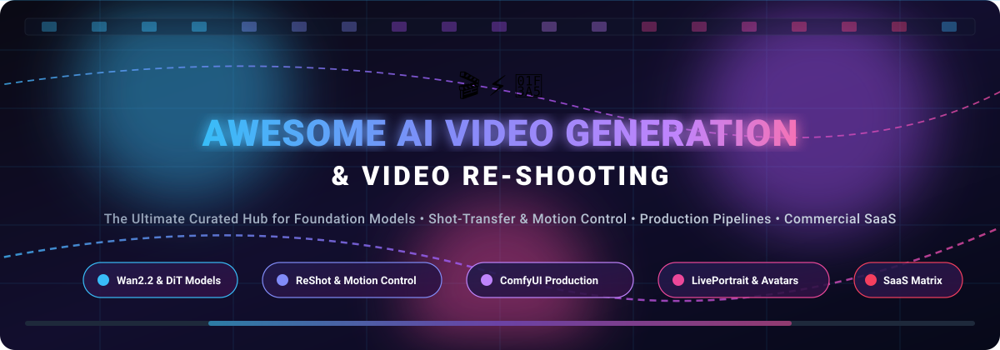

# Awesome-AI-Video-Generation-Re-Shooting

  

# 🎬 Awesome AI Video Generation & Re-Shooting 🎥

#### 🚀 A Curated Directory of Open-Source Foundation Models, Video Re-Shooting & Motion Control Pipelines, Production Workstations, and Commercial SaaS Platforms 🌟 Star if you like it! 🌟

  
  
  
  
  
  
  

*✨ Discover cutting-edge text-to-video (T2V), image-to-video (I2V), and video-to-video (V2V) generative AI models, shot-transfer / camera re-shooting pipelines, character motion control, and professional production workflows. 🎬*

---

## 📋 Table of Contents

- [📖 Overview & Key Concepts](#-overview--key-concepts)
- [🟢 Open-Source Ecosystem (Ranked by GitHub_Stars)](#-open-source-ecosystem-ranked-by-github-stars)
  - [🎥 Video Re-Shooting, Shot-Transfer & Motion Control](#-video-re-shooting-shot-transfer--motion-control)
  - [🧠 Foundation Video Generation Models (T2V / I2V)](#-foundation-video-generation-models-t2v--i2v)
  - [🎨 Node-Based UIs, Studios & Production Pipelines](#-node-based-uis-studios--production-pipelines)
  - [🎭 Character Animation, Lip-Sync & Portrait Re-Shooting](#-character-animation-lip-sync--portrait-re-shooting)
- [☁️ SaaS / Commercial Platforms](#️-saas--commercial-platforms)
  - [📈 Sector Overview & Market Dynamics](#-sector-overview--market-dynamics)
  - [📊 Commercial Platform Comparison & Pricing Matrix](#-commercial-platform-comparison--pricing-matrix)
- [🔄 Open-Source vs. SaaS Equivalent Matrix](#-open-source-vs-saas-equivalent-matrix)
- [⭐ Star History](#-star-history)
- [💖 Support & Sponsorship](#-support--sponsorship)
- [🤝 Contributing](#-contributing)

---

## 📖 Overview & Key Concepts

**AI Video Generation & Re-Shooting** encompasses the modern generative filmmaking and computational cinematography stack:

1. 🧠 **Foundation Video Generation (T2V / I2V):** Synthesizing temporally coherent, physics-aligned video clips from natural language text prompts, reference starting images, or first-and-last frame constraints.
2. 🎥 **Video Re-Shooting & Shot Control (V2V / ControlNet):** Extracting camera choreography, spatial depth maps, surface normals, optical flow, and human pose skeletons from existing live-action reference footage to re-render the scene with new actors, environments, or cinematic styles (*"copy the shot, not the actors"*).
3. 🎭 **Character Performance Retargeting:** Decoupling actor performances, facial micro-expressions, and vocal acoustics to drive high-fidelity digital humans, avatars, and character re-shooting without 3D rigging overhead.

---

## 🟢 Open-Source Ecosystem (Ranked by GitHub_Stars)

> 💡 Repositories are actively tracked and sorted in descending order by GitHub Stars_Count within each specialized category.

### 🎥 Video Re-Shooting, Shot-Transfer & Motion Control

Frameworks dedicated to extracting camera trajectories, depth, pose, and motion signals from reference videos to re-shoot scenes cleanly without leaking original actor identities.

* **[Wan-Video/Wan2.1 (VACE)](https://github.com/Wan-Video/Wan2.1)**  *(Apache-2.0)* — 🌟 **Video All-in-One Creation and Editing (VACE)**: Supports reference-to-video, video-to-video repainting, mask-based re-shooting, depth/pose/flow conditioning, and First-Last-Frame-to-Video (FLF2V) interpolation.
* **[guoyww/AnimateDiff](https://github.com/guoyww/AnimateDiff)**  *(Apache-2.0)* — 🎞️ Plug-and-play motion adapter module for Stable Diffusion paired with ControlNet (Depth, OpenPose, Lineart) and SparseCtrl for controllable video-to-video re-shooting.
* **[hao-ai-lab/FastVideo](https://github.com/hao-ai-lab/FastVideo)**  *(Apache-2.0)* — ⚡ Unified inference and post-training acceleration framework featuring progressive distillation for low-latency controllable video generation across HunyuanVideo and CogVideoX.
* **[MooreThreads/Moore-AnimateAnyone](https://github.com/MooreThreads/Moore-AnimateAnyone)**  *(Apache-2.0)* — 🕺 High-performance open-source implementation of pose-guided character animation and shot transfer with complete training and inference pipelines.
* **[Doubiiu/DynamiCrafter](https://github.com/Doubiiu/DynamiCrafter)**  *(Apache-2.0)* — 🔄 Controllable framework for animating open-domain images and generating looping dynamic video content with precise keyframe constraints.
* **[Yuanshi9815/OminiControl](https://github.com/Yuanshi9815/OminiControl)**  *(Apache-2.0)* — 🎛️ Minimal and universal conditional control framework for Diffusion Transformer (DiT) architectures, providing spatial conditioning, depth-to-video, and edge guidance.
* **[maosika-ai/reshot](https://github.com/maosika-ai/reshot)**  *(Apache-2.0)* — 🎬 **ReShot ("Copy the shot, not the actors")**: Extracts clean depth maps, OpenPose skeletons, and Canny edge sequences from reference footage to drive Seedance, MiniMax H3 ControlNet, and Wan VACE without leaking original actor identities. Includes a local Web UI and CLI.
* **[maosika-ai/ComfyUI-ReShot](https://github.com/maosika-ai/ComfyUI-ReShot)**  *(Apache-2.0)* — 🧩 Native ComfyUI custom nodes for the ReShot pipeline, enabling seamless shot choreography extraction and camera motion transfer directly inside visual node graphs.

---

### 🧠 Foundation Video Generation Models (T2V / I2V)

Open-weight base models serving as community-driven foundation alternatives to proprietary models like Runway Gen-3, Kling AI, Sora, and Luma Dream Machine.

* **[hpcaitech/Open-Sora](https://github.com/hpcaitech/Open-Sora)**  *(Apache-2.0)* — 🌐 Democratic high-performance open-source video generation pipeline providing data preprocessing, multi-stage training scripts, and model weights for variable-resolution video synthesis.
* **[Stability-AI/generative-models](https://github.com/Stability-AI/generative-models)**  *(SVD Community License)* — 🖼️ **Stable Video Diffusion (SVD / SVD-XT)**: Foundational open-weight latent diffusion models for synthesizing smooth temporal motion clips and multi-view sequences from single static images.
* **[Wan-Video/Wan2.2](https://github.com/Wan-Video/Wan2.2)**  *(Apache-2.0)* — 🏆 State-of-the-art Mixture-of-Experts (MoE) video foundation model suite (`T2V-A14B`, `I2V-A14B`, `TI2V-5B`, `Animate-14B`) delivering cinematic fidelity, lighting consistency, and physical accuracy.
* **[THUDM/CogVideo](https://github.com/THUDM/CogVideo)**  *(Apache-2.0)* — 🤖 Transformer-based video generation model series (**CogVideoX-2B / 5B / Fun**) renowned for exceptional text-prompt alignment, 3D VAE compression, and consumer GPU accessibility.
* **[Tencent-Hunyuan/HunyuanVideo](https://github.com/Tencent-Hunyuan/HunyuanVideo)**  *(Tencent Open License)* — 🐉 High-capacity open video foundation model (13B parameters) recognized for photorealistic motion dynamics, cinematic lighting, and custom spatial-temporal DiT architecture.
* **[PKU-YuanGroup/Open-Sora-Plan](https://github.com/PKU-YuanGroup/Open-Sora-Plan)**  *(Apache-2.0)* — 📐 Large-scale open reproduction of video foundation models featuring causal 3D video VAEs, high-fidelity diffusion transformers, and long video continuity.
* **[Lightricks/LTX-Video](https://github.com/Lightricks/LTX-Video)**  *(LTX Open License / Apache-2.0)* — ⚡ Ultra-fast DiT-based video foundation model designed for real-time inference speeds, minimal VRAM overhead, and high-FPS text-to-video generation.
* **[meituan-longcat/LongCat-Video](https://github.com/meituan-longcat/LongCat-Video)**  *(MIT)* — 🐱 Foundational video model series optimized for long-horizon narrative video generation and multi-modal audio conditioning.
* **[genmoai/mochi](https://github.com/genmoai/mochi)**  *(Apache-2.0)* — 🍡 **Mochi 1**: Asymmetric Diffusion Transformer (AsymmDiT) architecture focused on organic human locomotion, fluid kinetics, and prompt fidelity.
* **[AILab-CVC/VideoCrafter](https://github.com/AILab-CVC/VideoCrafter)**  *(Apache-2.0)* — 🎨 Comprehensive open toolkit for high-quality text-to-video, image-to-video, and video storyboarding (**VideoCrafter2**).
* **[ali-vilab/VGen](https://github.com/ali-vilab/VGen)**  *(Apache-2.0)* — 📦 Alibaba's official video generation framework hosting **I2VGen-XL**, **VideoComposer**, and **Hierarchical Video Generation**.
* **[showlab/Show-1](https://github.com/showlab/Show-1)**  *(Apache-2.0)* — 📽️ Efficient text-to-video model combining pixel-based and latent-based diffusion architectures to synthesize photorealistic clips with reduced compute demands.

---

### 🎨 Node-Based UIs, Studios & Production Pipelines

Local-first visual workstations, agentic timeline orchestrators, and infinite-canvas platforms for chaining generation, re-shooting, storyboarding, and video editing.

* **[comfyanonymous/ComfyUI](https://github.com/comfyanonymous/ComfyUI)**  *(GPL-3.0)* — 🧩 The industry-standard modular node-based orchestration engine for executing Wan2.2, HunyuanVideo, LTX-Video, CogVideoX, SVD, and ReShot ControlNet graphs locally.
* **[OpenMontageInc/OpenMontage](https://github.com/OpenMontageInc/OpenMontage)**  *(Apache-2.0)* — 🤖 Full-stack agentic video production system that plans, searches footage, generates AI shots, and automatically assembles coherent multi-track timelines.
* **[Anil-matcha/Open-Generative-AI](https://github.com/Anil-matcha/Open-Generative-AI)**  *(MIT)* — 🖥️ Self-hosted multi-model generative media studio supporting 600+ workflows, multi-image reference inputs, and local/remote GPU distribution.
* **[HBAI-Ltd/Toonflow-app](https://github.com/HBAI-Ltd/Toonflow-app)**  *(GPL-3.0)* — 📚 Infinite-canvas AI short-drama and motion-comic production workstation featuring character consistency locks, storyboarding, and local model dispatch.
* **[openfilm/openfilm](https://github.com/openfilm/openfilm)**  *(AGPL-3.0)* — 🎬 Open-source AI film agent and timeline editor enabling natural-language shot-by-shot revisions and manual multi-element manipulation.
* **[lcy362/agnes-video-generator](https://github.com/lcy362/agnes-video-generator)**  *(MIT)* — 🎙️ Self-hosted multi-scene video creation suite supporting text-to-video, keyframe animation, voiceover narration, and automated subtitle styling.
* **[LudwigKienle/ai-video-production-editor](https://github.com/LudwigKienle/ai-video-production-editor)**  *(MIT)* — 🎞️ Local-first Electron + React filmmaking workstation uniting scriptwriting, storyboarding, ComfyUI video synthesis, and non-linear multi-track editing.

---

### 🎭 Character Animation, Lip-Sync & Portrait Re-Shooting

Open-source alternatives to commercial avatar and motion-transfer platforms like HeyGen, Synthesia, and Viggle AI.

* **[KlingAIResearch/LivePortrait](https://github.com/KlingAIResearch/LivePortrait)**  *(MIT)* — 😃 Real-time portrait animation and subtle facial expression retargeting from driving reference videos, ideal for zero-shot performance re-shooting.
* **[duixcom/Duix-Avatar](https://github.com/duixcom/Duix-Avatar)**  *(Apache-2.0)* — 👤 Offline digital human and interactive AI avatar toolkit for voice-driven video synthesis, real-time live broadcasting, and character cloning.
* **[HumanAIGC/AnimateAnyone](https://github.com/HumanAIGC/AnimateAnyone)**  *(Research Ecosystem)* — 🕺 Landmark reference paper for pose-guided character image-to-video synthesis enabling seamless human body motion transfer.
* **[OpenTalker/SadTalker](https://github.com/OpenTalker/SadTalker)**  *(CC-BY-NC-4.0)* — 🗣️ Audio-driven 3D-MM talking head generation framework synthesizing realistic lip synchronization and head poses from single portrait images.
* **[magic-research/magic-animate](https://github.com/magic-research/magic-animate)**  *(Apache-2.0)* — ✨ Temporally consistent human image animation using diffusion models conditioned on DensePose motion sequences.
* **[Fudan-Generative-Vision/champ](https://github.com/Fudan-Generative-Vision/champ)**  *(MIT)* — 🕴️ Controllable and consistent human video generation framework utilizing 3D parametric SMPL models as motion shape condition guidance.
* **[guoqincode/Open-AnimateAnyone](https://github.com/guoqincode/Open-AnimateAnyone)**  *(Apache-2.0)* — 🏃 Lightweight community implementation of Animate Anyone built upon MagicAnimate and AnimateDiff motion backbones.
* **[Tencent/MimicMotion](https://github.com/Tencent/MimicMotion)**  *(Apache-2.0)* — 💃 High-fidelity human motion transfer framework using confidence-aware pose guidance for smooth, distortion-free full-body dance and action re-shooting.

---

## ☁️ SaaS / Commercial Platforms

### 📈 Sector Overview & Market Dynamics

The global AI video generation and computational cinematography market is estimated at **$850M to $1.2B in 2026** (scaling to over **$5.5B+** when incorporating enterprise synthetic media, localization, and automated video editing workflows) with an explosive compound annual growth rate (**CAGR of 25%–33%**). 

The market dynamics exhibit a distinct **hybrid bifurcation**:
- 🏛️ **Highly Concentrated at the Foundation Layer:** Enormous capital requirements, proprietary training superclusters, and multi-modal dataset scaling create high moats, leaving foundational generative video models dominated by well-capitalized tech titans and pure-play AI labs (Kuaishou, Runway, Luma AI, OpenAI).
- 🧩 **Moderately to Highly Fragmented at the Application Layer:** The SaaS application layer is characterized by intense specialization and fragmentation across vertical use cases—such as cinematic shot transfer, AI talking heads/avatars, social-first short-form video generation, and agency marketing automation.

---

### 📊 Commercial Platform Comparison & Pricing Matrix

> 📌 Platforms are sorted in descending order by company scale (enterprise market capitalization or private equity valuation).

| Platform | Company Scale (Valuation / Revenue) | Starting Paid Pricing Tier | Free Tier Limits / Trial Terms | Core Re-Shooting & Video Features |
| :--- | :--- | :--- | :--- | :--- |
| **[Kling AI](https://klingai.com)** | **~$11.4B–$14.2B Market Cap** *(Parent: Kuaishou Technology, HKEX: 1024)* | **$8.80 / month** *(Standard Plan; $6.60/mo billed annually, 660 monthly credits; promo: $6.99 1st month)* | **Free-for-ever Plan**: Grants **66 free credits daily** (resets every 24 hours, non-rollover); standard queue; watermarked outputs; non-commercial license. | Motion Brush, camera trajectory paths, high-fidelity lip-sync, 1080p generation, video-to-video styling. |
| **[Runway](https://runwayml.com)** | **~$5.3B Valuation** *(Series E; ~$300M annualized revenue)* | **$15.00 / month** *(Standard Plan; $12.00/mo billed annually, includes 625 monthly credits)* | **Free-for-ever Plan**: One-time starter allotment of **125 credits total**; 720p exports; 3 active video projects; watermarked outputs; non-commercial license. | Gen-3 Alpha / Gen-4, Video-to-Video, Act-One facial performance capture, Advanced Camera Controls, Motion Brush. |
| **[Luma Dream Machine](https://lumalabs.ai)** | **~$4.0B Valuation** *(Series C; 30M+ registered users)* | **$9.99 / month** *(Lite Plan; 3,200 monthly credits; Plus plan at $29.99/mo for commercial license)* | **Free-for-ever Plan**: Grants **~80 free credits daily** (resets every 24 hours, non-rollover); draft 720p outputs; watermarked generations; personal non-commercial license. | Ray 2 architecture, Keyframe Interpolation (FLF2V), Modify Video (re-shooting/re-texturing), custom camera moves. |
| **[Pika Labs](https://pika.art)** | **~$470M–$700M Valuation** *(~$135M VC funding raised)* | **$10.00 / month** *(Starter Plan; $8.00/mo billed annually, includes 900 monthly credits)* | **Free Account / Pay-As-You-Go**: **0 recurring free credits** included; free accounts can test UI and buy $5 pay-as-you-go credit packs (legacy promo allotments discontinued). | Pikaffects, Modify Region (video inpainting / object replacement), Lip Sync, Sound Effect generation. |
| **[Kaiber](https://kaiber.ai)** | **~$2.6M Annual Revenue** *(Bootstrapped / Lean Venture; 5M+ signups)* | **$10.00 / month** *(Starter Plan; $8.00/mo billed annually, includes 500 monthly credits; Creator at $29/mo)* | **Free Trial Only**: **5-day trial for $5** (includes 500 credits, full Canvas & Beat Sync access; converts to $29/mo if not cancelled). No permanent $0 tier. | Video-to-Video neural style transfer, Beat Sync audio-reactive animation, Infinite Canvas storyboarding. |
| **[Haiper AI](https://haiper.ai)** | **~$2.0M Annual Revenue** *(~$19.2M total venture funding raised)* | **$9.99 / month** *(Explorer Plan; includes high-priority queuing & HD upscaling)* | **Free-for-ever Plan**: Grants **~10 daily video generations** (~50 credits refreshing daily); 2s to 4s clip lengths; standard resolution (540p); non-commercial license. | Haiper 2.0 DiT model, Video Repainting (texture and style re-shooting), Keyframe conditioning, Motion Brush. |

---

## 🔄 Open-Source vs. SaaS Equivalent Matrix

For filmmakers, AI engineers, and developers looking to transition between proprietary cloud platforms and self-hosted open-source pipelines:

| SaaS Feature / Capability | Proprietary SaaS Representative | Open-Source Self-Hosted Alternative | Key Architectural Advantages of Open-Source |
| :--- | :--- | :--- | :--- |
| **Shot Transfer & Motion Extraction** | Runway Video-to-Video, Haiper Repaint | **[maosika-ai/reshot](https://github.com/maosika-ai/reshot)** + **[Wan2.1 VACE](https://github.com/Wan-Video/Wan2.1)** | Zero actor identity leakage, custom depth/canny weight control, zero subscription cost. |
| **Cinematic Text-to-Video (T2V)** | Runway Gen-3, Kling AI, Sora | **[Wan2.2](https://github.com/Wan-Video/Wan2.2)** / **[HunyuanVideo](https://github.com/Tencent-Hunyuan/HunyuanVideo)** | Uncensored local execution, full precision fp8/bf16 tuning, offline generation. |
| **Real-Time / Low-Latency T2V** | Luma Dream Machine (Flash) | **[Lightricks/LTX-Video](https://github.com/Lightricks/LTX-Video)** + **[hao-ai-lab/FastVideo](https://github.com/hao-ai-lab/FastVideo)** | Sub-second inference per frame on consumer GPUs, distilled DiT architectures. |
| **Actor Dance & Full-Body Pose Transfer** | Viggle AI, DomoAI | **[Moore-AnimateAnyone](https://github.com/MooreThreads/Moore-AnimateAnyone)** / **[MimicMotion](https://github.com/Tencent/MimicMotion)** | Direct OpenPose / SMPL-guided trajectory conditioning, no watermark restrictions. |
| **Facial Expression Performance Transfer** | Runway Act-One | **[KlingAIResearch/LivePortrait](https://github.com/KlingAIResearch/LivePortrait)** | Ultra-fast inference (30+ FPS), fine-grained facial expression retargeting. |
| **Production Workstation & Timeline Editor** | Runway Studio Canvas, Pika Canvas | **[ComfyUI](https://github.com/comfyanonymous/ComfyUI)** + **[ai-video-production-editor](https://github.com/LudwigKienle/ai-video-production-editor)** | Complete node flexibility, local filesystem integrations, multi-track non-linear editing. |

---

## ⭐ Star History

---

## 💖 Support & Sponsorship

Thank you so much for exploring this curated directory! If you find this resource helpful for your video research, cinematic AI experiments, or production pipelines, please consider supporting the project:

- ⭐ **Star the Repository:** Help increase visibility across the open-source community by starring this repo!
- 🍴 **Fork & Contribute:** Share your custom pipelines, new model releases, or benchmark comparisons via a pull request.
- 📢 **Share with Colleagues:** Share this repository with fellow filmmakers, AI creators, and machine learning researchers.
- ☕ **Buy Me a Coffee / Sponsor:** If this project saved you hours of curation and compute testing, support continued maintenance via the [GitHub Sponsor Dashboard](https://github.com/sponsors/ishandutta2007).

  

---

## 🤝 Contributing

Contributions are warmly welcome! If you know of an emerging open-source video model, shot-transfer framework, or production studio tool:

1. 🍴 Fork this repository.
2. 🌿 Create a new branch: `git checkout -b feature/add-new-tool`.
3. 📝 Add your tool to the corresponding section with a brief description and license tag.
4. 🔢 Ensure star-ranked or category consistency.
5. 🚀 Submit a pull request.

Please review our [Contribution Guidelines](https://github.com/ishandutta2007/Awesome-AI-Video-Generation-Re-Shooting/pulls) for detailed criteria.
